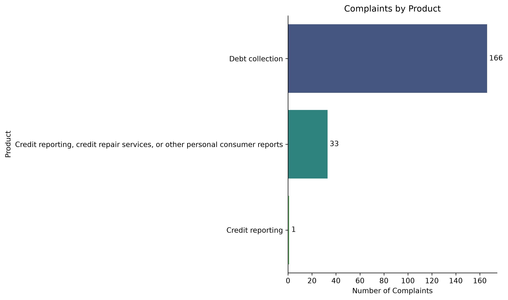
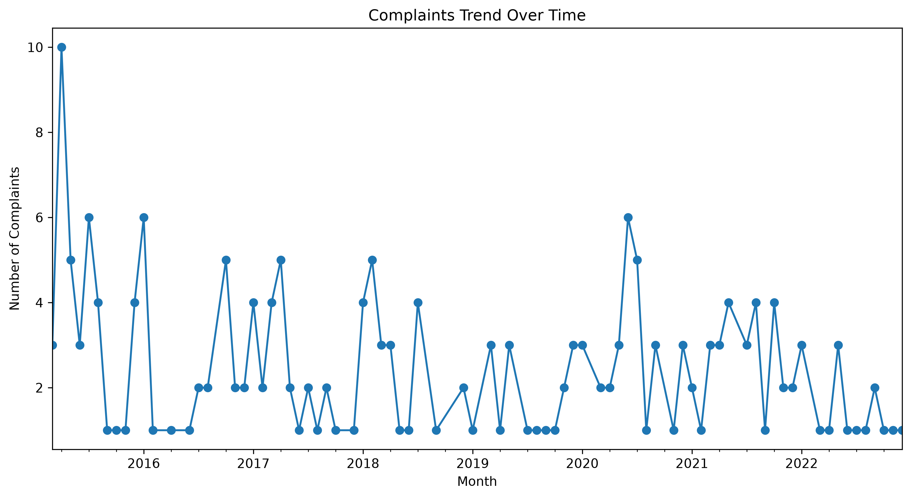
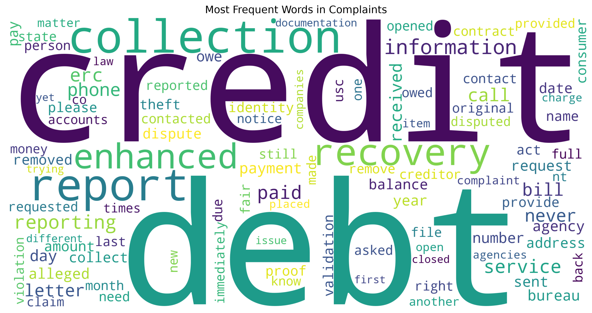
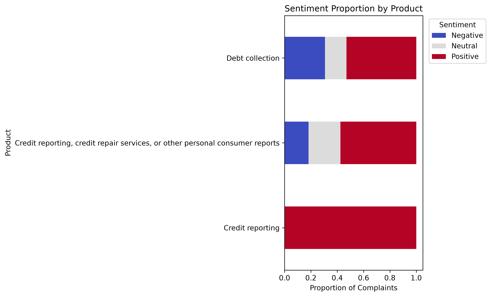
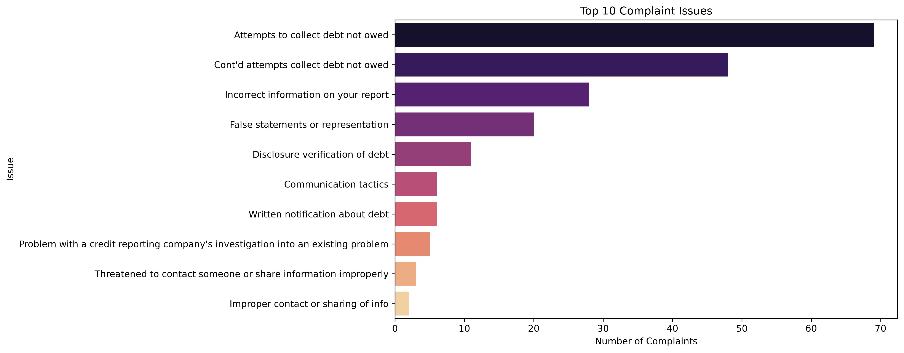

# Citi Bank Consumer Complaints Analysis

## Overview
This project analyzes consumer complaints data from the **Consumer Financial Protection Bureau (CFPB)**.  
Although the dataset covers multiple institutions, the analysis is adapted to Citi Bank’s context to demonstrate how customer feedback can be leveraged for **operational improvements, compliance, and customer experience strategy**.

## Dataset
- **Source:** CFPB Consumer Complaint Database (public, government-maintained)  
- **Scope:** Over 1 million complaints across financial products and services  
- **Focus:** Debt collection, credit reporting, credit repair services, and account servicing  
- **Note:** While not limited to Citi Bank, the dataset provides industry-wide insights applicable to Citi Bank’s operations.

## Methods
1. **Exploratory Data Analysis (EDA)**  
   - Complaint distribution by product  
   - Trends over time  
   - Word frequency and word cloud visualization  

2. **Sentiment Analysis**  
   - TextBlob scoring (initial baseline)  
   - Identified anomalies (positive bias in complaint text)  
   - Recommendation to validate with **VADER** for improved accuracy  

3. **Theme Extraction (Topic Modeling)**  
   - Latent Dirichlet Allocation (LDA)  
   - Extracted 5 recurring themes:  
     - Debt collection & payment  
     - Communication & contact practices  
     - Credit reporting accuracy  
     - Validation & compliance (FDCPA)  
     - Account services & billing  

## Results

### Complaint Distribution by Product

The majority of complaints are concentrated in debt collection and credit reporting.

### Trends Over Time

Complaints show a long-term decline but periodic spikes, indicating unresolved systemic issues.

### Word Frequency

Frequent terms highlight debt, credit, and collection practices.

### Word Cloud

Visual representation of the most common complaint terms.

### Sentiment Analysis

TextBlob results show suspiciously high positive sentiment, suggesting tool bias.

### Top 10 Complaint Issues

Debt collection dominates, followed by credit reporting and account servicing.

## Key Findings
- **Debt collection** has the highest negative sentiment (~31%).  
- **Credit reporting** shows suspiciously positive sentiment, likely due to small sample size or TextBlob bias.  
- **Neutral complaints** are concentrated in credit repair services (~24%), suggesting ambiguous customer experiences.  
- Only three products dominate the filtered view, requiring confirmation of dataset scope.  

## Recommendations to Citi Bank
1. **Strengthen debt verification and compliance** to reduce wrongful collection attempts.  
2. **Improve communication practices** — respectful, transparent, and compliant customer interactions.  
3. **Enhance credit reporting accuracy** through stronger data validation and collaboration with bureaus.  
4. **Optimize account services** — billing accuracy, payment posting, and balance transparency.  
5. **Validate sentiment tools** (e.g., VADER) to ensure accurate measurement of customer sentiment.  
6. **Continuous monitoring** — quarterly reviews of complaint data to detect emerging issues and measure improvements.  

## Tools & Technologies
- Python (Pandas, NumPy, Matplotlib, Seaborn)  
- TextBlob (sentiment analysis)  
- Scikit-learn (topic modeling with LDA)  
- Jupyter Notebook for analysis and visualization  

## Project Structure
├── CFPB Consumer Complaints 2024 Analysis.ipynb   # Main notebook
├── data/                                          # Dataset files
├── images/                                        # Visualizations (charts, word clouds)
└── README.md                                      # Project documentation
## Conclusion

Combining **EDA, sentiment analysis, and theme extraction** gives Citi Bank a practical view of where customers are struggling. Improving debt collection practices, communication, and credit reporting accuracy is likely to strengthen customer trust and satisfaction.
